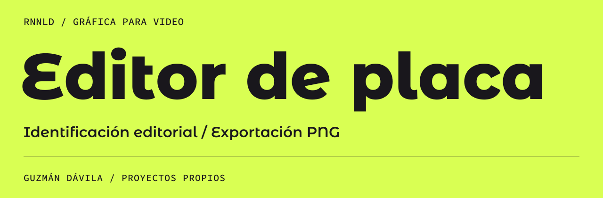
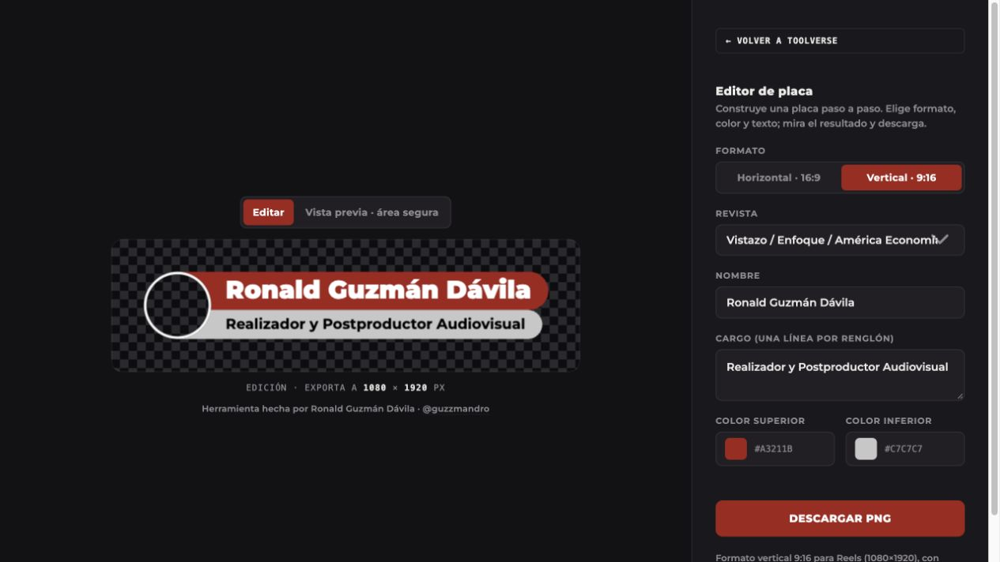

[← Perfil principal](https://github.com/guzmandavila) &nbsp; / &nbsp; [Portafolio ES](https://github.com/guzmandavila/portfolio/blob/main/PORTFOLIO_ES.md) &nbsp; / &nbsp; [Portfolio EN](https://github.com/guzmandavila/portfolio/blob/main/PORTFOLIO_EN.md)

### [Abrir editor ↗](https://guzmandavila.github.io/Editor-de-placa/)

Herramienta web para componer placas de identificación con nombre y cargo. Permite elegir formato, ajustar colores, previsualizar el área segura y exportar un PNG con transparencia.

## Formatos y controles

| Función | Disponible |
| :--- | :--- |
| Horizontal · 16:9 | 1280 × 720 px |
| Vertical · 9:16 | 1080 × 1920 px |
| Textos | Nombre y cargo en varias líneas |
| Colores | Perfiles editoriales y selección manual |
| Vista previa | Edición y guía de área segura |
| Entrega | PNG con transparencia |

## Cómo utilizarlo

1. Elige el formato y el perfil editorial.
2. Escribe el nombre y el cargo; ajusta los colores.
3. Revisa la composición y su ubicación en la vista de área segura.
4. Descarga el PNG e incorpóralo a tu edición.

## Implementación

La interfaz, los estilos y el dibujo en Canvas están en `index.html`. La tipografía de la aplicación es Montserrat y se carga desde Google Fonts. Publicado en GitHub Pages, sin proceso de compilación.

**Relacionado:** [Toolverse — portal de herramientas](https://github.com/guzmandavila/toolverse).

---

[Perfil principal](https://github.com/guzmandavila) &nbsp; / &nbsp; [Escríbeme ↗](https://wa.me/593979864314)
